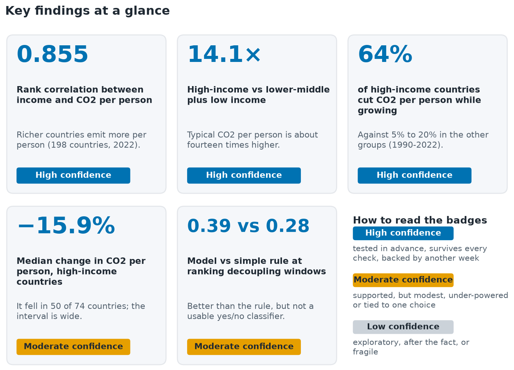
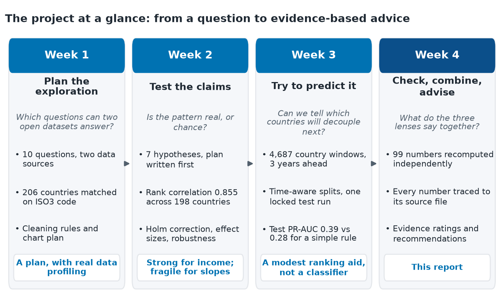
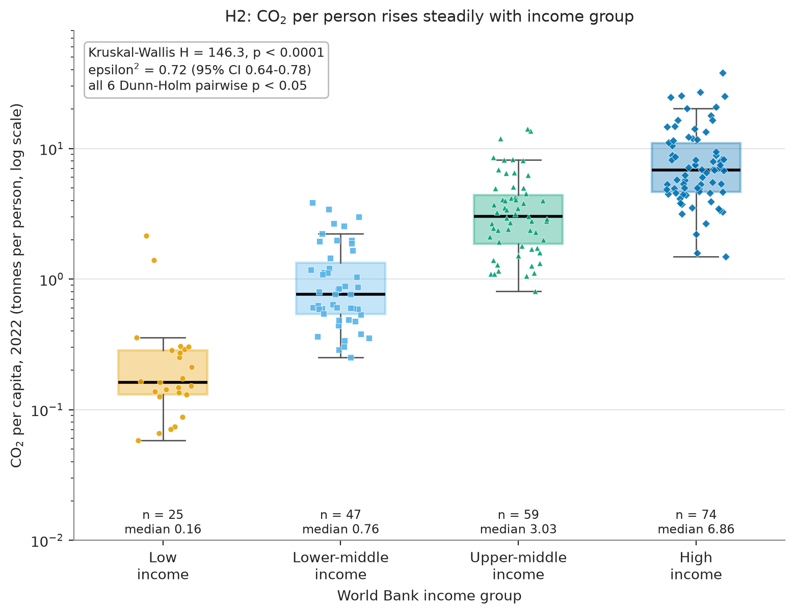
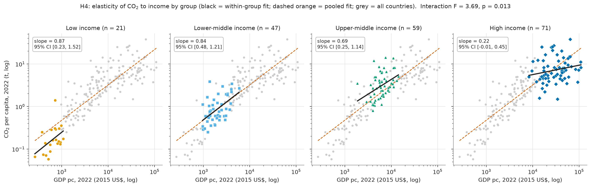

# Does Wealth Burn Carbon? Comprehensive Data Science Project Report and Recommendations

*Week 4 Task - Comprehensive Data Science Project Report and Recommendations (synthesis of the Week 1, Week 2 and Week 3 work)*

---

## 1. Executive summary

### 1.1 The question

Do richer countries burn more carbon? And can a country grow richer while its carbon emissions per person fall? This report calls the second outcome *decoupling* (carbon dioxide, or CO2, per person goes down while income per person goes up). It combines three earlier pieces of work on about 198 countries between 1990 and 2022, using open data from Our World in Data and the World Bank.

### 1.2 What we did

In Week 1 we planned the exploration and checked the data. In Week 2 we wrote down 7 claims before looking at the results and tested them. In Week 3 we built a machine-learning model that predicts which countries will decouple over the next three years, and tested it once on years it had never seen. In this final week we recomputed the headline numbers with different code (99 of 99 checks agree), traced every number to a source file, and rated how far each finding can be trusted.

### 1.3 Five key findings



- **Richer countries emit more per person.** The rank correlation between income and CO2 per person is 0.855 (a perfect match would score one and no link zero). *High confidence.*
- **The gap is large.** High-income countries emit about 14.1 times as much CO2 per person as lower-middle and low-income countries combined. *High confidence.*
- **Decoupling is mostly a high-income story.** Between 1990 and 2022, 64% of high-income countries decoupled, against 5% to 20% in the other groups. Still, 36% of high-income countries did not. *High confidence.*
- **Most high-income countries cut emissions per person.** The median fall was 15.9% and CO2 per person fell in 50 of 74 countries, but the effect is moderate and the test could only just detect it. *Moderate confidence.*
- **The model ranks better than a simple rule, but it is not a decision tool.** Its ranking score was 0.39 against 0.28 for a rule that copies the recent past (a model with no skill scores about 0.25, the share of true cases). At its fixed cut-off it flagged almost every window. *Moderate confidence.*

### 1.4 Five recommendations

The full list of 8 recommendations, with evidence, next steps and success measures, is in Section 8. The five that matter most:

- **R1.** Use income groups as a starting lens, not a verdict, and always show how many countries break the group pattern. *High confidence.*
- **R2.** Measure decoupling over multi-year windows and report CO2 counted where it is produced next to CO2 counted where goods are consumed. *Moderate confidence.*
- **R3.** Do not use the Week 3 model for yes/no decisions. Use it only as a ranking aid, with its precision shown next to the base rate. *Moderate confidence.*
- **R5.** Treat the finding that the income-emissions link is flatter at high income as provisional until it is repeated. *Low confidence in the finding.*
- **R6.** Pin data versions, store checksums and refresh once a year with a change report. *High confidence.*

These are evidence-informed analytical recommendations. Policy decisions would need evidence about cause and effect, which this project does not provide.

### 1.5 The biggest caveat

All results describe patterns across countries, not causes. CO2 is counted where it is produced, so a rich country can look as if it decoupled because the goods it buys are now made, and the carbon emitted, elsewhere. The report cannot tell how much of the measured decoupling is of this kind.

### 1.6 How to read the rest of this report

Managers can read Sections 1, 5.4, 7, 8 and 11. Technical readers will want Sections 3 to 5, 9 and the appendices. Method sections open with a short plain-English summary, and every number can be traced through the claims ledger (Appendix B).

## 2. Introduction

| In short |
| --- |
| This project asks whether richer countries emit more carbon, and whether growth and falling emissions can go together. It was built in four steps: plan, test, predict, and (this report) check and combine. The report is written for managers first and technical readers second. |

### 2.1 The problem

Carbon dioxide from burning fossil fuels and making cement is the largest single human cause of climate change. Countries differ enormously in how much they emit, how rich they are, and how their energy is produced. A long-running idea says that countries pollute more as they grow richer, then less once they are rich enough. Economists call this the environmental Kuznets curve (Grossman and Krueger, 1995). Later reviews found that the evidence for carbon dioxide is weak and depends on the sample and the method (Stern, 2004). This project tests the question with open data rather than assuming an answer.

The question is harder than it looks. Totals are dominated by a few very large economies. Per-person values are dominated by a few very small, fuel-exporting ones. The two data sources name countries differently. Much of the history is missing. A careless analysis would produce a confident but wrong headline.

### 2.2 Why it matters

An organisation that wants to set priorities, report progress or decide where to look first needs to know three things. Is income a useful way to group countries? Is the growth-without-extra-carbon outcome rare or common? And can a model tell in advance which countries are heading that way? Wrong answers are costly in both directions. Treating income as destiny hides the countries that break the pattern. Trusting a weak model sends effort to the wrong places.

### 2.3 Who this report is for, and how to read it

The first audience is a manager who needs the answer, the confidence in it and the next steps. The second is a technical reviewer who needs to see how every number was produced. The report serves both by putting a plain-English summary at the start of each method section, and by moving the detail into tables, figures and appendices.

**Table 2.1: Where to start, by type of reader.**

| Reader | Start with | Then read |
| --- | --- | --- |
| Manager or sponsor | Sections 1 and 11 | Sections 5.4, 7 and 8 |
| Analyst who will reuse the results | Sections 3 and 5 | Sections 4, 9 and 10 |
| Technical reviewer | Sections 4 and 5.5 | Appendices A and B |
| Anyone meeting a new term | Section 2.5 | Appendix C |

### 2.4 The four-week project at a glance

The work was done in four steps. Each step used the earlier ones as its starting point and kept its own repository, listed with commit hashes in Appendix A.



- **Week 1: plan the exploration.** It chose two open datasets, found and fixed their quirks on paper, set out 10 questions and the charts that would answer them, and profiled the real data. The full exploratory analysis was planned but not run.
- **Week 2: test the claims.** It wrote an analysis plan before opening the data, then ran 7 hypothesis tests (6 confirmatory, one exploratory) with corrections for running several tests at once.
- **Week 3: try to predict decoupling.** It built a model that predicts, for a country in a given year, whether decoupling will happen over the next 3 years. The design was fixed in advance and the final test was run once.
- **Week 4: check, combine and advise.** This report recomputes the key numbers, compares the three sets of results, rates the evidence and turns it into recommendations.

### 2.5 A short glossary

The terms below are used throughout. A longer list is in Appendix C.

**Table 2.2: Terms used in this report.**

| Term | What it means here |
| --- | --- |
| CO2 per person | Tonnes of carbon dioxide from fossil fuels and cement produced inside a country in a year, divided by its population. |
| Income per person | Economic output per person in constant 2015 US dollars (World Bank GDP per person). |
| Decoupling | Always *absolute* decoupling: CO2 per person falls while income per person rises. |
| Income group | The World Bank's four classes: low, lower-middle, upper-middle and high income (current classification). |
| Production-based emissions | Emissions counted where the carbon is released, not where the goods are used. |
| Rank correlation | A score for how well the order of countries on one measure matches their order on another: high means a close match, zero means none. |
| Hypothesis test | A procedure that asks whether a pattern is larger than chance alone would produce. |
| Confidence interval | A range that is likely to contain the true value; wide means uncertain. |
| PR-AUC | A score between zero and one for how well a model puts true cases near the top of its list. A model with no skill scores the share of true cases. |
| Base rate | The share of cases that are true to begin with (here, the share of windows in which decoupling happens). |
| Post hoc | Decided after the results were seen, so treated as exploratory. |

## 3. Data and lineage

| In short |
| --- |
| Two open datasets were joined on country codes and cleaned with written rules. The same OWID file and the same World Bank values were used in Weeks 2 and 3, and Week 1's reported counts are consistent with them. The three weeks use different definitions of "decoupling" and different samples, so their numbers must not be mixed without the translation given in Section 3.5. |

### 3.1 Sources and what they measure

**Our World in Data (OWID) CO2 dataset.** One file of 50,411 rows and 79 columns (14.4 MB), covering 1750 to 2024. It holds 254 entities, of which 218 are countries and 36 are regions, groups or special categories. The key measure is CO2 per person from fossil fuels and industry, counted where the carbon is released (production-based).

**World Bank World Development Indicators.** Downloaded through the public API: income per person (GDP per person, constant 2015 US dollars), population, the urban share of the population and industry's share of GDP, plus the metadata that assigns each country to an income group. The download holds 266 entities, of which 44 are regional or income-group aggregates.

Both sources are open (OWID and the World Bank state that their data may be reused with credit). The analysis window is 1990 to 2022, chosen in Week 1 because CO2 and population are nearly complete from 1990, OWID's own GDP column stops in 2022, and 1990 is a common baseline year.

### 3.2 Cleaning rules

Each rule answers a problem measured in Week 1's profiling, not a generic checklist. The rules were written in Week 1, applied in Week 2 and ported unchanged to Week 3.

**Table 3.1: The cleaning rules and what they affected.**

| Rule | Why | What it affected |
| --- | --- | --- |
| Remove aggregates (regions, income groups, "World") | Counting a region and its countries double counts emissions. | 35 OWID entities and 79 World Bank aggregates. |
| Join on the three-letter ISO3 country code, never on names | Names differ: "Egypt" against "Egypt, Arab Rep.". | 206 countries matched on codes against 177 on names, so a name join would have lost 29. |
| One manual crosswalk for Kosovo | It has a code at the World Bank but none in OWID. | 33 rows re-keyed. |
| Never fill in CO2 or income | They are the outcome and the main driver; filling them in would invent the pattern under study. | Rows missing either are dropped from that analysis only, and counted. |
| Keep zero CO2 values but exclude them from logarithms | Zeros are real in the early record of two territories, but a logarithm is undefined. | 10 country-years. |
| One income series: World Bank GDP per person, constant 2015 US dollars | OWID's own GDP column is missing for 24.8% of country-years in the window, against 6.4% at the World Bank. | Used throughout; the PPP series is a check only. |
| Restrict to 1990-2022 | CO2 is missing for only 1.6% of country-years in this window. | Week 3 reads 1988-1989 as look-back only. |


### 3.3 How many countries entered each analysis

Every test and every model uses only the countries that have the variables it needs. Nobody is dropped silently: each step is counted in the earlier repositories' sample-flow tables, reproduced below.

**Table 3.2: Sample flow in Weeks 2 and 3 (counts as reported by those weeks).**

| Analysis | Step | Remaining | Dropped at this step |
| --- | --- | --- | --- |
| Week 2 (income and emissions, 2022) | all country entities (WB country list U OWID countries) | 229 | 0 |
| Week 2 (income and emissions, 2022) | no CO2 pc in 2022 (or <= 0) | 214 | 15 |
| Week 2 (income and emissions, 2022) | no GDP pc in 2022 (or <= 0) | 198 | 16 |
| Week 3 (decoupling windows) | all entity-years, t = 1993-2019 | 6,183 | 0 |
| Week 3 (decoupling windows) | no CO2 per capita > 0 at t | 5,765 | 418 |
| Week 3 (decoupling windows) | no GDP per capita > 0 at t | 5,294 | 471 |
| Week 3 (decoupling windows) | no CO2 per capita > 0 at t+3 | 5,294 | 0 |
| Week 3 (decoupling windows) | no GDP per capita > 0 at t+3 | 5,283 | 11 |

In Week 2 the income-and-emissions test started with 229 country entities and kept 198 after removing 15 without CO2 in 2022 and 16 without income. In Week 3 the table starts from country-years, not countries, and ends with 5,283 eligible three-year windows, of which 4,687 fall in the training pool or the test set. The remainder start in the three years between them, which Week 3 deliberately left unused.

### 3.4 Lineage and consistency across the weeks

This report rests on three earlier repositories. Table 3.3 gives the exact commit read for each one.

**Table 3.3: The earlier work this report draws on.**

| Week | Repository | Commit used | What it contributed | Pytest checks |
| --- | --- | --- | --- | --- |
| Week 1 | [co2-economy-eda-proposal](https://github.com/KanishkVerma-046/co2-economy-eda-proposal) | `cb3a0dfcde` | Question, two data sources, cleaning rules, exploratory plan, chart choices, preliminary profiling (a plan with real profiling; the full exploratory analysis was not run). | none |
| Week 2 | [co2-gdp-hypothesis-testing](https://github.com/KanishkVerma-046/co2-gdp-hypothesis-testing) | `4348fdd9a0` | Analysis plan committed before the tests; hypotheses H1-H7 (H1-H6 confirmatory, Holm correction); cleaned 2022 cross-section and 1990-2022 paired tables; effect sizes, robustness, power. | 25 reported; 24 pass and 1 fail on a fresh clone here |
| Week 3 | [co2-decoupling-ml-pipeline](https://github.com/KanishkVerma-046/co2-decoupling-ml-pipeline) | `67d512561a` | ML plan committed before any model; leakage-safe 3-year-ahead decoupling label and splits; model comparison; one locked test run; post hoc comparison of saved predictions. | 31 reported; 31 pass and 0 fail on a fresh clone here |

A synthesis is only valid if the weeks used the same data. We compared the raw-file fingerprints (sha256 hashes) that Weeks 2 and 3 recorded, and then compared the overlapping values directly.

**Table 3.4: Whether the weeks used the same data vintage.**

| File | Same hash in Weeks 2 and 3? | What the comparison shows |
| --- | --- | --- |
| `owid-co2-codebook.csv` | n/a | used in only one of Weeks 2 and 3 |
| `owid-co2-data.csv` | yes | identical file (same sha256) |
| `wb_NV.IND.TOTL.ZS.csv` | no | hash differs only because the requested year range differs (1990-2022 vs 1988-2022); all 8778 overlapping 1990-2022 rows have identical values |
| `wb_NY.GDP.PCAP.KD.csv` | no | hash differs only because the requested year range differs (1990-2022 vs 1988-2022); all 8778 overlapping 1990-2022 rows have identical values |
| `wb_NY.GDP.PCAP.PP.KD.csv` | n/a | used in only one of Weeks 2 and 3 |
| `wb_SP.POP.TOTL.csv` | no | hash differs only because the requested year range differs (1990-2022 vs 1988-2022); all 8778 overlapping 1990-2022 rows have identical values |
| `wb_SP.URB.TOTL.IN.ZS.csv` | no | hash differs only because the requested year range differs (1990-2022 vs 1988-2022); all 8778 overlapping 1990-2022 rows have identical values |
| `wb_country_metadata.csv` | yes | identical file (same sha256) |
| `owid-co2-data.csv (Week 1, by reported facts only)` | not checkable | Week 1 reported 14.38 MB, 50,411 rows x 79 columns, years 1750-2024; Weeks 2 and 3 recorded 14,377,942 bytes (= 14.38 MB). Consistent with the same file, but a hash was not stored in Week 1, so identity cannot be proven. |
| `NY.GDP.PCAP.KD (Week 1, by reported facts only)` | not checkable | Share of country rows missing in 1990-2022: Week 1 profiling 6.41%, Week 2 cleaning log 459 of 7,161 = 6.41%. Agree. |
| `NY.GDP.PCAP.PP.KD (Week 1, by reported facts only)` | not checkable | Share of country rows missing in 1990-2022: Week 1 profiling 10.63%, Week 2 cleaning log 761 of 7,161 = 10.63%. Agree. |
| `NV.IND.TOTL.ZS (Week 1, by reported facts only)` | not checkable | Share of country rows missing in 1990-2022: Week 1 profiling 15.63%, Week 2 cleaning log 1,119 of 7,161 = 15.63%. Agree. |

The outcome, stated plainly:

- **OWID: identical.** The file has the same fingerprint in Weeks 2 and 3. Week 1 recorded no fingerprint, but its reported file size and shape match.
- **World Bank: same values.** The files differ in fingerprint only because Week 2 requested 1990-2022 and Week 3 requested 1988-2022. For every overlapping row (8,778 rows per indicator file) the values are identical (0 differences). Week 1's missing-data rates for three indicators agree with Week 2's cleaning log to two decimals.
- **One tooling problem, no data problem.** Week 2's own checksum test fails on a fresh clone (1 of 25 checks), because its World Bank files were fingerprinted with Windows line endings and stored with Unix ones. Restoring the line endings reproduces the recorded fingerprints. Section 8 turns this into a recommendation.

Had the vintages differed, the weeks' numbers would not be comparable: a revised income value changes a country's rank, its income group and whether it counts as decoupled. Because they match, differences between weeks can be traced to definitions, not data.

### 3.5 Reconciling definitions across the weeks

The weeks answer related but different questions, so some numbers look inconsistent when they are not. The clearest case is decoupling. Week 2 asks whether a country's CO2 per person was lower, and income per person higher, in 2022 than in 1990: one comparison over 184 countries, with 32% of them decoupling. Week 3 asks the same question over any three-year window and counts windows, not countries: about 26.8% of windows in the training period decoupled and 24.9% in the test years. Short windows catch a country in a bad year; the long comparison hides the ups and downs between the two end years.

**Table 3.5: Definitional differences between the weeks, and how this report treats them.**

| Topic | Week 1 | Week 2 | Week 3 | Why it differs | How this report handles it |
| --- | --- | --- | --- | --- | --- |
| **What counts as one observation** | A country (planned). A country-year panel for the data join. | One row per country: the 2022 cross-section, or one 1990-to-2022 pair. | One row per country and window start year. Windows overlap, so a country appears many times. | Each week answers a different question. | Each result is described with its unit. Counts of countries and counts of windows are never mixed. |
| **Definition of decoupling** | A four-way class from growth rates over 1990-2022 (planned). | Absolute decoupling between two end years: CO2 per person lower in 2022 than in 1990 and GDP per person higher. | Absolute decoupling over a rolling three-year window: CO2 per person lower and GDP per person higher after 3 years. | A 33-year comparison and a 3-year window ask different questions. | 'Decoupling' always means absolute decoupling. The word 'long-run' is used for the two-end-year version and 'window' for the three-year version. |
| **Headline decoupling numbers** | None computed. | 64% of high-income countries and 32% of all countries compared decoupled between 1990 and 2022. | 26.8% of pool windows and 24.9% of test windows were decoupling windows (43% for high income in the test years). | One counts countries over 33 years; the other counts country windows over three years, and a window can fail simply because of a bad year. | Both are shown with their definitions. They are not to be compared directly. |
| **Sample sizes** | 197 countries in the preliminary 2022 correlation; 6,798 joined country-years in 1990-2022. | 198 countries for H1, 205 for H2, 146 for H3, 74 for H5 and 184 for H6. | 201 countries in the pool and 198 in the test set; 4,687 windows. | Each analysis needs different variables to be present, so different countries drop out. | Every figure and table states its own n. |
| **Income-group classification** | Current World Bank groups: 76 high, 58 upper-middle, 47 lower-middle and 25 low income in the joined set. | The same current groups, applied to countries with CO2 data in 2022: 74, 59, 47 and 25. | The same current groups, used only to describe results and never as a model feature. | The counts differ because the samples differ, not because the classification differs. | One classification (the current one) throughout, with the caveat that countries have moved between groups. |
| **Income measure** | World Bank GDP per person, constant 2015 US$ (primary); PPP as a check. | The same, with PPP as a robustness variant. | The same constant 2015 US$ series. | None. | Constant 2015 US$ everywhere, unless a PPP check is mentioned. |
| **Emissions measure** | OWID CO2 per person from fossil fuels and industry, production-based. Consumption-based CO2 planned for 120 countries. | Production-based only. | Production-based only. | Consumption-based data were planned but never used. | Production-based throughout. The limitation is stated wherever decoupling is mentioned. |
| **Time coverage** | Study window 1990-2022. | Cross-section 2022 and the 1990 to 2022 change. | Window start years 1993 to 2019 (three-year windows ending 2022 at the latest), look-back from 1988; pool 1993 to 2013, test 2017 to 2019. | Time-aware validation needs years of history before each window. | The over-time figure shows start years 1993 to 2019 and marks the test years. |
| **Preliminary versus final correlation** | Rank correlation 0.857 on 197 countries (smoke test). | Rank correlation 0.855 on 198 countries. | Not applicable. | One more country is included in Week 2; the preliminary figure was never meant to be final. | Week 2's figure is the result. Week 1's is a consistency check. |

Two further points. First, Week 1's preliminary rank correlation (0.857 on 197 countries) and Week 2's (0.855 on 198) differ only because Week 2 includes one more country; Week 1's figure was a smoke test and is used only as a consistency check. Second, the income-group counts differ between weeks because the samples differ, not because the classification does. Throughout, the current World Bank classification is applied to all years, which is a limitation (Section 9).

## 4. Methodology

### 4.1 Data cleaning and preparation

| In short |
| --- |
| The data were cleaned by written rules, each tied to a measured problem. Nothing that matters for the result was filled in, and every dropped or changed row was logged. |

Section 3.2 lists the rules. Three design choices deserve explanation, because they shape every later result.

*Why not fill in missing values?* CO2 and income are the two things the project studies. Guessing them would partly manufacture the relationship being tested. Where gaps were small and in secondary variables (industry share, for example), Week 3 compared four ways of filling them and found the choice made no real difference: all four scored within one standard error of each other for every model.

*Why logarithms?* Both CO2 per person and income per person are very uneven: a few countries are far above the rest. Plotted or averaged on their raw scale, those few dominate. On a logarithmic scale, each step up is a multiplication (ten times, for example) rather than an addition, which spreads countries out evenly and turns the income-emissions pattern into something close to a straight line. Week 1's profiling measured this: the skew of raw CO2 per person in 2022 was 2.53, against -0.60 after taking logs.

*Why ranks?* Rank-based statistics ask only whether the order of countries agrees, so one extreme value, such as Qatar's 37.9 tonnes per person, cannot dominate.

### 4.2 Exploratory analysis and visualisation strategy (Week 1)

| In short |
| --- |
| Week 1 matched each question to a chart type and wrote down colour and accessibility rules before drawing anything. It also ran a first profile of both datasets. The planned exploratory analysis was not carried out in full; the pictures in Section 5.1 execute the parts that matter most. |

Week 1 defined 10 questions, from "how have emissions changed since 1990?" to "how sensitive are the main findings to data choices?". Each question was paired with a method and a chart, such as a log-log scatter for income against emissions and a quadrant plot for decoupling. Colour rules were fixed up front: one hue for magnitude, two hues with a neutral middle for change, never colour alone to carry meaning, no dual-axis charts, and axis labels that say when a scale is logarithmic.

Week 1's real contribution was measurement. The profiling quantified the missing data, found the country-name mismatches and showed why logarithms are needed (Figure 4.1).


An honest note on scope: Week 1 was a plan, backed by profiling and a preliminary rank correlation. It did not produce the exploratory findings it planned. This report fills the gap in two ways: Weeks 2 and 3 supply the tests and the model, and Section 5.1 draws the three most important planned pictures (income against emissions, decoupling by group, decoupling over time) from the saved Week 2 and Week 3 data.

### 4.3 Statistical testing framework (Week 2)

| In short |
| --- |
| The claims were written down before the data were opened. Each was tested with a method suited to skewed data, corrected for running several tests at once, and reported with an effect size and an interval rather than a bare yes or no. |

**Pre-specification.** The analysis plan was committed to version control before any test was run. It fixed the hypotheses, the direction of each, the sample, the test and the decision rule. This guards against the quiet habit of trying many analyses and reporting the one that worked.

**The hypotheses.** Seven in all. H1 to H6 were confirmatory; H7 was exploratory and sits outside the correction.

- H1: richer countries emit more CO2 per person (rank correlation).
- H2 and H3: CO2 per person differs across the four income groups, and high-income countries emit more than lower-middle and low-income countries together.
- H4: the slope of the income-emissions line differs by income group.
- H5: CO2 per person fell in high-income countries between 1990 and 2022.
- H6: decoupling depends on income group.
- H7 (exploratory): industry share and urbanisation add explanatory power beyond income.

**Why these tests.** Because the data are skewed, the primary tests rely on ranks or on corrections for uneven spread: Spearman's rank correlation (Spearman, 1904) for H1, the Kruskal-Wallis test for H2, Welch's t-test for H3, an interaction test with robust standard errors for H4, the Wilcoxon signed-rank test for the paired comparison in H5, and a chi-square test for H6. Each has a companion test run for comparison, so a result does not depend on one method's assumptions.

**Multiple testing.** Running six tests, each at the usual 5% error level, gives a much higher chance than 5% that at least one false alarm slips through. The Holm procedure adjusts the six p-values so that the chance of any false alarm across the whole set stays at 5%. It is never less powerful than the simpler Bonferroni method.

**Effect sizes and intervals.** A p-value says only that a pattern is unlikely to be chance. It does not say how big the pattern is. Every result is therefore reported with an effect size and a 95% interval from a bootstrap, which re-draws the sample many times to see how much the answer moves (Efron, 1979).

**Power.** The plan computed the smallest effect each design could detect with 80% power. For H5 the observed effect was just below it (0.25 against a minimum of 0.29), which is why H5 is rated Moderate in Section 5.4.

**Robustness.** Each confirmatory test was re-run with PPP income, without countries under one million people, without oil and gas exporters, and with permutation tests. Only H4 changed meaningfully.

### 4.4 Machine learning (Week 3)

| In short |
| --- |
| The model answers one question: for a country in a given year, will CO2 per person fall while income per person rises over the next three years? It was built so that it never sees the future, compared with simple baselines, and evaluated once on years it had not touched. |

**The label.** For a country and a start year, the label says *decoupling* if CO2 per person is lower and income per person higher 3 years later, and *no decoupling* otherwise. This is the same absolute decoupling as in Week 2, applied to a rolling window. 4,687 windows were eligible across the training pool and test set, from 201 countries.

**The features.** 20 measures known at the start of the window: income level and recent growth, population, urbanisation, industry share, CO2 per person and how it changed over the last one, three and five years, energy use, and the coal, oil and gas shares of CO2. Year, country identity and income group were left out on purpose: the first two let a model memorise, and the third is circular with income.

**The models.** Three were tried: an elastic-net logistic regression (Zou and Hastie, 2005) (a simple, penalised formula), a random forest (Breiman, 2001) and gradient boosting (Friedman, 2001) (both ensembles of decision trees). Two baselines gave a yardstick: a *persistence rule* (predict decoupling if it happened over the previous three years) and a *base-rate rule* (always predict the average).

**Time-aware validation.** Random shuffling would let a model learn from the future. Instead, windows starting in 1993-2013 formed a pool for training and tuning, and the years 2017-2019 were held back for the final test. A gap of 3 years sat between them so that no training window overlapped the test period (Figure 4.2). Inside the pool, models were scored with rolling-origin validation: train on the past, validate on the next block, repeat.


**Choosing a model.** The rule, set in advance, was to take the model with the best cross-validated PR-AUC unless a simpler one was within one standard error of it. PR-AUC (area under the precision-recall curve) suits this task because decoupling windows are the minority: it measures how well true cases are ranked near the top and has a clear no-skill line (Saito and Rehmsmeier, 2015). The random forest scored highest (0.384) but the logistic regression (0.346) cleared the cut-off (0.334), so it was chosen. A cut-off for turning scores into yes or no was fixed by maximising F1 on out-of-fold predictions; it came to 0.124.

**Metrics and uncertainty.** Besides PR-AUC, the report uses ROC-AUC, precision, recall, F1 and the Matthews correlation coefficient (MCC), which stays honest when classes are unbalanced (Chicco and Jurman, 2020). Intervals come from a bootstrap that re-draws whole countries, because windows from one country are not independent.

**One test run.** After the configuration was frozen, the test years were scored once; a lock file blocks a second run. Later comparisons read the saved predictions only and are labelled post hoc.

### 4.5 Quality assurance

| In short |
| --- |
| Quality was built in at four levels: plans written first, automated tests, a ledger that ties every number to a file, and an independent recomputation of the headline numbers. |

- **Pre-specified plans.** Weeks 2 and 3 each committed their plan before touching data or models, and logged every later deviation.
- **Pytest suites.** Week 2 reports 25 checks and Week 3 reports 31. Run here from fresh clones, Week 3 passes all of them and Week 2 passes 24 of 25; the one failure is the line-ending issue in Section 3.4.
- **A claims ledger.** Every number in this report is a row in `results/claims_ledger.csv` with its source repository, commit, file and column. The report is built from a template with placeholders, so a number cannot drift from its evidence.
- **Independent verification.** `src/verify_headlines.py` recomputes the headline numbers from saved data and saved predictions with different code (Section 5.5).

## 5. Results

### 5.1 What the data look like

| In short |
| --- |
| Richer countries emit more per person and high-income countries are the ones that mostly decouple, but even among them only about a third decouple in a typical three-year window. The lower-income groups show no clear trend. |

**Income and emissions.** Figure 5.1 plots every country in 2022: income per person across, CO2 per person up, both on logarithmic scales. The dots rise from lower left to upper right, and the orange trend line captures most of the pattern. The rank correlation is 0.855 (95% interval 0.802 to 0.893, 198 countries). Two features deserve attention. The spread around the line is wide: at similar incomes, CO2 per person differs by a factor of ten or more, which is where fuel mix, climate and industry come in. The cloud also flattens among the richest countries, a hint (tested as H4 in Section 5.2) that more income no longer means proportionally more carbon there.


**Decoupling by group, 1990 to 2022.** Figure 5.2 compares each country's 1990 and 2022 values. The bars rise sharply with income. In the high-income group 43 of 67 countries (64%, 95% interval 52% to 75%) cut CO2 per person while their income grew. In the other groups the shares are 5% (1 of 20), 9% (4 of 43) and 20% (11 of 54). Across all 184 countries compared, 32% decoupled. The low-income interval is wide because the group is small.


**Decoupling over time.** Figure 5.3 asks the same question for every three-year window from 1993 to 2019. The high-income line rises from 21% in the first window to 56% in the last, with large swings in between. In a typical window 37% of high-income countries decouple (47% in windows starting since 2010), and high income has the highest share of the four groups in 23 of 27 windows. For all countries the share rose from 17% to 30%. The lower groups show no steady trend: low income goes from 19% to 14% and lower-middle income from 11% to 11%. Windows starting in 2017 to 2019 end in the pandemic years, so the right-hand end should be read with care.


These figures are descriptive. The next two sections ask whether the patterns could be chance, and whether they predict anything.

### 5.2 Statistical tests

| In short |
| --- |
| All six confirmatory tests were significant after correction, but they are not equally strong. Income, group differences and decoupling by group are robust. The decline in high-income emissions is moderate. The difference in slope is fragile. |

**Table 5.1: Primary results of the seven hypotheses (Week 2), with the confidence rule applied to each.**

| ID | Question | Countries | Effect size [95% interval] | Holm-adjusted p | Robustness checks passed | Confidence |
| --- | --- | --- | --- | --- | --- | --- |
| H1 | Do richer countries emit more CO2 per person? | 198 | Spearman rho 0.855 [0.802, 0.893] | below 0.001 | 4 of 4 | **High** |
| H2 | Does CO2 per person differ across the four income groups? | 205 | epsilon-squared 0.717 [0.644, 0.782] | below 0.001 | 3 of 3 | **High** |
| H3 | Do high-income countries emit more than lower-middle plus low income combined? | 146 | Cohen's d 3.057 [2.680, 3.550] | below 0.001 | 4 of 4 | **High** |
| H4 | Is the income-emissions slope different by income group? | 198 | delta R-squared (interaction block) 0.010 [0.003, 0.026] | 0.0155 | 4 of 6 | **Low** |
| H5 | Did CO2 per person fall in high-income countries, 1990 to 2022? | 74 | matched-pairs rank-biserial r -0.324 [-0.568, -0.067] | 0.0155 | 4 of 4 | **Moderate** |
| H6 | Is decoupling linked to income group? | 184 | Cramer's V 0.532 [0.413, 0.655] | below 0.001 | 3 of 3 | **High** |
| H7 | Do industry share and urbanisation add to income? (exploratory) | 194 | increment in R-squared 0.050 [0.027, 0.085] | not adjusted | not applicable | **Low** |

**Income and emissions (H1 to H3).** The H1 rank correlation of 0.855 survives every check: with PPP income (0.869, 195 countries), without countries under one million people (0.862) and without oil and gas exporters (0.884). Median CO2 per person rises at every step up the income ladder, from 0.16 tonnes in low-income countries to 0.76, 3.03 and 6.86 tonnes (Figure 5.4). Every pair of groups differs after correction. High-income countries emit about 14.1 times as much per person as lower-middle and low-income countries combined, a gap that holds without small countries (14.5 times) and without oil and gas exporters (12.6 times). The standardised effect (Cohen's d of 3.06) is unusually large, partly because groups are defined from income.



**Decoupling by group (H6).** The share of countries that decoupled rises from 5% in low-income countries to 64% in high-income ones, and the chi-square test rejects independence (Cramer's V = 0.53, interval 0.41 to 0.66). The odds of decoupling in a high-income country are about 11.3 times those elsewhere (interval 5.3 to 22.4), and the effect is no smaller with PPP income or without small countries or oil exporters. Figure 5.5 shows where the table departs from independence: high-income countries decouple far more often than expected, every other group less often.


**Did high-income emissions fall (H5)?** Yes, moderately. Among 74 high-income countries with data in both years, the median change in CO2 per person was a fall of 15.9% (95% interval -24.8% to -9.6%), and it fell in 50 countries. The result holds without small countries (median -20.4%) and without oil exporters (-17.0%). Two cautions. The effect size (-0.32) has an interval ending at -0.07, close to zero. And the design could detect a paired effect of 0.29, but the observed effect was 0.25, so the evidence is real but not overwhelming (adjusted p = 0.0155).

**The weakest result: do slopes differ (H4)?** The test says yes (adjusted p = 0.0155), but the extra variance explained is only 0.010 of the total, about one percent. The estimated slopes run from 0.87 for low-income countries down to 0.22 for high-income ones: among poorer countries a doubling of income goes with a near-proportional rise in emissions, while among the richest the link is nearly flat (Figure 5.6). But 2 of the 6 robustness checks did not reach the usual significance level: without small countries the p-value is 0.074 and the planned label-permutation check gives 0.052. The honest summary is: there is some evidence of a flatter slope at high income, but it depends on which countries are included. This is why it is rated Low and recommended for replication (R5).



**Structural drivers (H7, exploratory).** Adding industry share and urbanisation to income raises the share of variance explained from 0.73 to 0.78 (an extra 0.05, 194 countries). Industry carries the effect: each extra percentage point of industry in the economy goes with about 2.2% more CO2 per person at the same income. Urbanisation shows no clear effect once income and industry are accounted for (the interval runs from -0.0006 to 0.0044). Because this analysis was exploratory and its p-values were not corrected, it is rated Low.

### 5.3 Machine learning

| In short |
| --- |
| The model puts decoupling windows nearer the top of its list than a simple rule does, but not by much. Used as a yes/no classifier it is close to useless. A free rule that just uses a country's income group does about as well, and two other models scored higher after the fact. |

**Setting.** Of the 4,093 windows in the training pool, 1,095 (26.8%) were decoupling windows. In the test set, 148 of 594 (24.9%) were. A model with no skill would therefore score a PR-AUC of about 0.25 on the test set.

**Main result.** The chosen logistic regression scored a test PR-AUC of 0.390 (95% interval 0.31 to 0.50), against 0.284 for the persistence rule. The paired difference was 0.106 (interval 0.051 to 0.192), which excludes zero, so the pre-specified success criterion for ranking was met. In cross-validation the model's score was lower (0.346), so there is no sign that tuning inflated the test score. Pooled out-of-fold predictions showed the same advantage over persistence (0.053, interval 0.027 to 0.084).

**Table 5.2: Test results for all models (start years 2017 to 2019; precision, recall, F1 and MCC at each model's frozen threshold).**

| Model | PR-AUC [95% interval] | ROC-AUC | Precision | Recall | F1 | MCC |
| --- | --- | --- | --- | --- | --- | --- |
| Logistic regression (chosen in advance) | 0.390 [0.31, 0.50] | 0.688 | 0.254 | 0.993 | 0.405 | 0.072 |
| Random forest (post hoc comparison) | 0.471 [0.37, 0.58] | 0.700 | 0.285 | 0.926 | 0.436 | 0.172 |
| Gradient boosting (post hoc comparison) | 0.467 [0.37, 0.56] | 0.696 | 0.297 | 0.939 | 0.451 | 0.213 |
| Persistence rule | 0.284 [0.23, 0.34] | 0.568 | 0.337 | 0.392 | 0.362 | 0.130 |
| Base rate only (prior) | 0.249 [0.21, 0.29] | 0.500 | 0.000 | 0.000 | 0.000 | 0.000 |


**As a yes/no classifier it fails.** At its frozen threshold the logistic regression flagged 431 windows that did not decouple as decoupling and cleared only 15, while catching 147 of the 148 true cases. Its precision (0.254) was about the base rate and its MCC was 0.072 (interval 0.010 to 0.116), lower than the persistence rule's 0.130. The threshold rule, which maximises F1, drifts to "flag almost everything" when a model separates the classes only weakly. Week 3 pre-specified this rule and kept it.

**Much of the skill is income.** In a post hoc check, a rule that gives each window the training-period base rate of its income group scored a PR-AUC of 0.379. The logistic regression's advantage over it was 0.011 (interval -0.048 to 0.089), which is indistinguishable from nothing. In plain terms, what the linear model mostly learned is the Week 2 finding that richer countries decouple more often. Within income groups its ranking is weak; for lower-middle-income countries its ROC-AUC was 0.46, below the 0.500 of a coin flip. Among the subgroups, the share of windows that decoupled ranges from 10% (low income) to 43% (high income).

**Two other models scored higher, after the fact.** The random forest scored 0.471 and gradient boosting 0.467. The logistic regression minus the forest was -0.081 (interval -0.138 to -0.024), and the forest beat the income-group rule by 0.092 (interval 0.018 to 0.172), which hints at structure beyond income. These comparisons are post hoc. Switching to the forest after seeing the test set would turn the test set into a selection tool, so the pre-specified choice stands and the forest result is a lead for the next round (R4).

**A plain-language view (post hoc).** Table 5.3 asks a simpler question: if you took only the top 20% of windows by model score (119 windows), how many would really decouple? The base rate is 24.9%.

**Table 5.3: Precision among the top-scored 20% of test windows (post hoc, exploratory, not pre-specified).**

| Model | Top-scored windows that really decoupled [95% interval] | Times the base rate | Gain over the base rate [95% interval] |
| --- | --- | --- | --- |
| Logistic regression (selected model) | 47% [36%, 58%] | 1.9 | 22 points [13, 31] |
| Random forest | 52% [39%, 62%] | 2.1 | 27 points [16, 36] |
| Gradient boosting | 45% [34%, 56%] | 1.8 | 20 points [11, 30] |
| Persistence rule | 34% [26%, 42%] | 1.4 | 9 points [3, 15] |

The logistic regression's top-scored fifth was right 47% of the time, about 1.9 times the base rate. The persistence rule's top fifth was right 34%. This is a more intuitive way to see the same modest ranking gain; the 20% cut was fixed in advance for presentation and was not tuned.

**What the model leans on.** Shuffling income per person in the test data cost 0.179 of PR-AUC, the largest drop of any feature, followed by the oil share of CO2 (0.086). Urbanisation mattered in cross-validation but not on the test set (0.002). Using recent changes in CO2 and income alone, the model scored 0.255, no better than the base rate; adding economic structure raised it to 0.350 and fuel mix to 0.390. A country's recent trajectory says almost nothing about its next three years.


Robustness did not change the order. Without the first test year, whose window ends in 2020, the logistic regression scored 0.485 against 0.331 for persistence. Without countries under one million people it scored 0.456 against 0.311.

### 5.4 Triangulation: where the three lenses agree and where they do not

| In short |
| --- |
| Income is the common thread: all three weeks point to it. Beyond income, the evidence thins out. Each finding is rated High, Moderate or Low by a fixed rule, not by how interesting it is. |

Three kinds of evidence are laid side by side in Table 5.4: the Week 1 exploration, the Week 2 tests and the Week 3 model.

**Table 5.4: The project's main questions, what each week said, and how far the answer can be trusted.**

| Question | Week 1 (exploration) | Week 2 (tests) | Week 3 (model) | Do they agree? | Confidence |
| --- | --- | --- | --- | --- | --- |
| **Q-A.** Does income relate to emissions per person? | Planned. A preliminary rank correlation of 0.857 on 197 countries. | Yes. Rank correlation 0.855 (0.802 to 0.893) across 198 countries; holds under all 4 robustness checks. | Income per person is the strongest model feature (shuffling it costs 0.179 of PR-AUC). | Agree | **High** |
| **Q-B.** Do income groups differ? | Planned a group comparison; no result. | Yes. Median CO2 per person rises from 0.16 to 6.86 tonnes across the four groups; high income is 14.1 times lower-middle plus low income. | Decoupling windows differ sharply: 43% in high-income countries against 10% to 15% elsewhere. | Agree | **High** |
| **Q-C.** Have rich countries decoupled? | Planned a decoupling quadrant plot; no result. | Mostly. 64% of high-income countries decoupled against 5% to 20% elsewhere. Median change -15.9%, with CO2 per person down in 50 of 74. | On average 37% of high-income countries decouple in a three-year window (21% for the first window, 56% for the last). | Agree, with a gap in strength | **Moderate** |
| **Q-D.** What predicts decoupling? | Not addressed. | Income group (Cramer's V 0.53). Not tested beyond that. | Income level carries most of the signal. Momentum alone adds nothing (PR-AUC 0.255 against 0.249 for no skill). A free income-group rule scores 0.379, close to the model's 0.390. | Agree on income; beyond income, weak | **Moderate** |
| **Q-E.** Do structural drivers matter? | Planned (industry share, urbanisation); no result. | Exploratory. Industry share adds explanatory power (about 2.2% more CO2 per person per extra point); urbanisation does not clearly. | Oil share and industry share carry some signal; urbanisation matters in cross-validation but not on the test set (0.002). | Partly disagree on urbanisation | **Low** |

**The confidence rule.** The rule was fixed before the analysis. *High*: pre-specified; every pre-specified robustness check agrees; the corrected p-value is below 0.01 (or a paired interval for a model comparison excludes zero); the repository raised no power warning; and another week's evidence backs it. *Moderate*: pre-specified and supported, but at least one of those conditions fails and no more than one robustness check does. *Low*: exploratory, post hoc, planning-stage only, or two or more robustness checks fail. For tests H1 to H6 the counts are computed from Week 2's results file, so the rating is mechanical.

**Table 5.5: The rule applied to every finding.**

| ID | Finding | Kind of evidence | Robustness checks passed | Rating | Why |
| --- | --- | --- | --- | --- | --- |
| H1 | Income and CO2 per person rise together across countries | hypothesis test | 4 of 4 | **High** | all conditions met |
| H2 | CO2 per person differs across the four income groups | hypothesis test | 3 of 3 | **High** | all conditions met |
| H3 | High-income countries emit far more per person than lower-income countries | hypothesis test | 4 of 4 | **High** | all conditions met |
| H4 | The income-emissions slope is flatter in high-income countries | hypothesis test | 4 of 6 | **Low** | 2 of 6 robustness variants do not reach raw p < 0.05; Holm-adjusted p = 0.0155 (not below 0.01); not corroborated by another week |
| H5 | CO2 per person fell in high-income countries between 1990 and 2022 | hypothesis test | 4 of 4 | **Moderate** | Holm-adjusted p = 0.0155 (not below 0.01); observed effect size is below the minimum detectable effect (0.29) flagged in Week 2 |
| H6 | Absolute decoupling is far more common in high-income countries | hypothesis test | 3 of 3 | **High** | all conditions met |
| H7 | Industry share (not urbanisation) adds explanatory power beyond income (exploratory) | hypothesis test | 2 of 2 | **Low** | exploratory, outside the confirmatory family; not corroborated by another week |
| M1 | The selected model ranks decoupling windows better than the persistence rule | model comparison (pre-specified) | 2 of 2 | **Moderate** | paired interval excludes zero and both variants agree, but the gain is modest, there is a single COVID-shaped test period, and a free income-group base rate scores about the same (post hoc) |
| M2 | At the frozen threshold the selected model is not useful as a yes/no classifier | model evaluation (pre-specified) | 2 of 2 | **Moderate** | no usefulness threshold was pre-specified, so the judgement rests on MCC and precision against the base rate; test MCC 0.072, precision 0.254 |
| M3 | An income-group base rate scores about as well as the selected model | post hoc comparison | none run | **Low** | post hoc: added after the test set was seen |
| M4 | Random forest and boosting score higher than the selected model on the test set | post hoc comparison | none run | **Low** | post hoc; the pre-specified choice was not changed |
| M5 | Precision among the highest-scored windows exceeds the base rate | new post hoc metric | none run | **Low** | new in Week 4, computed after the test set was seen; plain-language aid only |
| S1 | Structural drivers (industry share, fuel mix) matter beyond income; urbanisation does not clearly | exploratory + model importance | 2 of 2 | **Low** | Week 2's test was exploratory (unadjusted p), Week 3 importance is predictive not causal, and urbanisation results disagree across weeks |
| P1 | Data lineage can be checked, and was: same OWID file, identical World Bank values, one checksum test failing on line endings | process observation | none run | **High** | observed directly and verified by src/lineage.py; no inference involved |
| P2 | Headline numbers carry wide or fragile intervals that a bare number would hide | process observation | none run | **High** | observed in the saved results and recomputed independently |
| E1 | Week 1's preliminary rank correlation between income and CO2 per person | planning-stage smoke test | none run | **Low** | a planning-stage smoke test, not a result of the exploratory analysis; used only as a consistency check |

Of the seven hypotheses, 4 are rated High, 1 Moderate and 2 Low. Figure 5.10 shows which lens supports which finding.


Where the lenses agree, the agreement is on income. Where they disagree, it is about detail: Week 2 finds no clear urbanisation effect while Week 3's model leans on it in cross-validation, and the forest's test-set advantage, seen only after the fact, contradicts the rule that chose the logistic regression. None of these disagreements overturns a headline finding; each is why a related finding is rated lower.

### 5.5 Independent verification

| In short |
| --- |
| The headline numbers were recomputed with different code from saved data. All checks agree with the originals. |

`src/verify_headlines.py` recomputed 99 quantities from the saved processed data and saved predictions, with code written independently of the earlier repositories: rank correlation from ranks, its interval from a new bootstrap, decoupling flags rebuilt from the 1990 and 2022 values, the Week 3 label rebuilt from the panel, and every test metric and confusion matrix recomputed from the saved predictions at the frozen thresholds. Of 99 checks, 99 passed and 0 failed.

**Table 5.6: Selected verification checks. Tolerances are set before running: exact for counts and exact formulas, 0.02 for bootstrap interval ends because a different random seed changes them slightly.**

| Quantity | Original | Recomputed here | Difference | Tolerance | Result |
| --- | --- | --- | --- | --- | --- |
| Countries in the income-emissions correlation (n) | 198 | 198 | 0 | 0 | pass |
| Spearman rho, GDP per person vs CO2 per person (2022) | 0.8548 | 0.8548 | 0 | 1e-09 | pass |
| Lower end of the 95% interval for rho | 0.8021 | 0.801 | 0.001 | 0.02 | pass |
| Upper end of the 95% interval for rho | 0.8929 | 0.8929 | 3e-05 | 0.02 | pass |
| High-income to lower-income ratio of geometric-mean CO2 per person | 14.1 | 14.1 | 0.005 | 0.005 | pass |
| Share decoupled 1990-2022, High income (%) | 64.18 | 64.18 | 0 | 1e-09 | pass |
| Share decoupled 1990-2022, Low income (%) | 5 | 5 | 0 | 1e-09 | pass |
| Median change in CO2 per person, high-income countries (%) | -15.9 | -15.93 | 0.03 | 0.05 | pass |
| Log-log slope of CO2 on income, High income | 0.2203 | 0.2203 | 1e-16 | 1e-09 | pass |
| Base rate of decoupling windows, pool | 0.2675 | 0.2675 | 0 | 1e-12 | pass |
| Base rate of decoupling windows, test | 0.2492 | 0.2492 | 0 | 1e-12 | pass |
| Test windows whose saved label differs from the rebuilt label | 0 | 0 | 0 | 0 | pass |
| Test PR-AUC, Logistic regression | 0.3901 | 0.3901 | 6e-17 | 1e-09 | pass |
| Test ROC-AUC, Logistic regression | 0.6885 | 0.6885 | 1e-16 | 1e-09 | pass |
| Test MCC, Logistic regression | 0.0718 | 0.0718 | 0 | 1e-09 | pass |
| Test confusion count FP, Logistic regression | 431 | 431 | 0 | 0 | pass |
| Test PR-AUC, Persistence rule | 0.2837 | 0.2837 | 0 | 1e-09 | pass |

The rank correlation (0.855), the ratio (14.1) and the test PR-AUC (0.390) all reproduce, and 0 of the 594 test windows have a saved label that differs from the independently rebuilt one. The checks verify arithmetic and consistency. They do not prove the underlying data are right, or that the definitions are the best ones.

## 6. Visualisation and communication

| In short |
| --- |
| Each chart was chosen for the question it answers, drawn so that the first thing a reader sees is the finding, and checked for colour-blind safety. Uncertainty is shown on the chart, not buried in a footnote. |

### 6.1 How the chart types were chosen

A chart type is a promise about what the eye can compare. People judge positions along a common scale most accurately, lengths almost as well, and areas and colour shades least well (Cleveland and McGill, 1984). So the charts here put the quantity that matters on a position or a length, and use colour only to say which group a mark belongs to. The Week 1 principle of choosing the chart from the question, not the other way round, was applied to every figure.

**Table 6.1: Chart choices, with the alternatives that were rejected and why.**

| Figure | Question it answers | Chart type | Why this form | Alternatives rejected | Design choices |
| --- | --- | --- | --- | --- | --- |
| 1.1 Key findings | What are the headline results and how far can they be trusted? | Tiles with one large number and a badge | Managers read numbers first; a badge puts the confidence next to each number | A table of results (too dense for a first look) | Badge says the level in words, so colour is never the only cue |
| 2.1 Journey | What was done in each step? | Four labelled boxes with arrows | The story is a sequence | A long vertical flowchart (too tall for a page) | Landscape, short sentences, no jargon |
| 5.1 Income and CO2 | How are income and CO2 per person related? | Scatter on logarithmic axes with a trend line | A scatter shows every country, the shape and the spread | A bar chart of averages (hides the spread); a map (shows place, not relationship) | Ticks show real dollars and tonnes; a handful of countries labelled directly |
| 5.2 Decoupling by group | How common is decoupling in each group? | Bars with intervals and counts | Bars are the clearest way to compare shares across four ordered groups | Pie charts (hard to compare); bars without intervals (hide uncertainty) | Direct labels give the percent and the counts; one dashed line for all countries |
| 5.3 Decoupling over time | Is decoupling becoming more common, and for whom? | Lines, one per group | Lines show change over time and let groups be compared | Stacked areas (hide individual groups); one panel per group (harder to compare) | Labels at the line ends instead of a legend; test years shaded |
| 5.7 Model skill | How good is the model, in plain terms? | Dot-and-interval plot plus bars | Intervals show that differences between models are small | A table of scores only; an ROC curve (harder for non-specialists) | No-skill line drawn; post hoc results marked in the figure itself |
| 5.10 Evidence matrix | How strong is the evidence for each finding? | Grid of symbols with a rating column | It shows at a glance which findings rest on one week only | A paragraph (slower); a heat map (implies a scale that does not exist) | Symbols differ in shape, not only in colour, and are explained in a key |
| 8.1 Roadmap | In what order should the recommendations be acted on? | Three columns of cards | Order and confidence are the two things a manager needs | A Gantt chart (implies dates and effort that are not known) | One badge per card |

**Design choices that apply everywhere.**

- **Colour-blind-safe palette.** A blue, vermilion, orange and grey set that stays distinct under common forms of colour blindness (Wong, 2011), checked with a palette validator. Ordered groups (income) use one hue from light to dark, the usual rule for ordered categories (Harrower and Brewer, 2003). Nothing depends on colour alone: shapes, labels and words repeat the message.
- **Logarithmic scales explained.** Where income or CO2 spans several orders of magnitude, axes are logarithmic. The axis label says so in words ("each step is ten times more"), and the ticks show real values, not powers of ten.
- **Direct labels.** Names sit next to the lines, bars and dots they describe, so readers do not have to look back and forth to a legend.
- **Honest axes and plain labels.** Bars start at zero, no chart has two vertical scales, and axes read "Income per person (US$, log scale)" rather than a variable name.

### 6.2 Reading the key visuals

**The scatter (Figure 5.1).** Read it as a *tendency across countries*. The trend line is not a law: two countries with the same income can differ as much as a low-income and a high-income country. A reader should come away with "income tells you a lot, but not everything". The labelled countries make that concrete: Qatar sits far above the line, Switzerland well below it. Income groups are a good first sort and a poor last word.

**Decoupling by group (Figure 5.2).** The jump at the high-income bar is the story, and the intervals are the discipline: small groups give wide ranges. The dashed line makes a second point: across all countries, only about a third decoupled. Decoupling is not the norm but an outcome of particular conditions, which are more common in rich countries.

**Decoupling over time (Figure 5.3).** The eye is drawn to the high-income line, and rightly. But the zig-zag is also information: in one window the share can swing by tens of percentage points, which a single end-point comparison (Figure 5.2) hides. The shaded bands show which years the model never used and which it was tested on.

**Model skill (Figure 5.7).** The left panel puts all four models on one scale against the no-skill line. The overlapping intervals are the message: the models are better than chance and better than the simple rule, but not by much, and they are hard to tell apart. The right panel translates the score into something a manager can use ("of the top-scored fifth, about half decoupled") and is clearly labelled post hoc. The implication is that the model is at best a ranking aid.

**Evidence matrix (Figure 5.10).** The matrix shows how many findings depend on one lens only. The top rows are filled in two or more columns; the lower rows are mostly empty or half-filled. A reader should leave knowing which findings can be repeated to a sceptical audience and which need a caveat.

### 6.3 Communicating uncertainty to non-technical readers

- **Say what the number is and how sure we are, side by side.** One format throughout: number, interval, confidence badge.
- **Use words as well as numbers.** "About half" and "roughly one in three" help; the exact value follows in brackets.
- **Show intervals as lines on the chart.** A range drawn as a whisker is read faster than a range written in a sentence.
- **Say when a result was decided after the fact.** The words *post hoc* are explained once and then used consistently, and charts carry the label in the figure itself.
- **Separate "unlikely to be chance" from "large".** Effect sizes come first, in plain words.
- **Name what the data cannot say.** The caveat about production-based emissions travels with every mention of decoupling.

### 6.4 Common ways charts mislead, and how these figures avoid them

**Table 6.2: Misleading practices and the countermeasures used in this report.**

| Way a chart misleads | What was done instead |
| --- | --- |
| A truncated axis makes a small gap look large. | Bars start at zero. |
| Two vertical axes let any two lines appear to move together. | No dual axes; separate panels are used. |
| A log scale that is not explained makes a skewed cloud look tame. | Log scales are named in the axis label with plain-language ticks. |
| Averages hide spread, as in Anscombe's classic examples (Anscombe, 1973). | The scatter shows every country; bars carry intervals. |
| Small groups look as solid as large ones. | Counts are printed on the bars and intervals drawn. |
| Colour alone carries the meaning, which fails for colour-blind readers. | Labels, shapes and words repeat the meaning. |
| A cherry-picked end-point hides what happened in between. | The over-time figure shows every window. |
| A good-looking model score hides a poor decision rule. | Both ranking skill and the frozen-threshold result are shown. |
| Results found after the fact are shown as if planned. | They are marked post hoc in the chart and in the text. |

## 7. Discussion

| In short |
| --- |
| Across countries, wealth and carbon go together, strongly. Among the richest countries the link has loosened, and most have cut emissions per person. But the cut is partial, may partly reflect imported emissions, and cannot be predicted well. |

### 7.1 What the evidence says about "does wealth burn carbon"

Across countries, yes, and strongly: a rank correlation of 0.855, an income-group gap of about 14.1 times, and income per person as the strongest feature in the predictive model. These come from different weeks and methods, and they agree: it is the most secure finding in the project.

Within the richest countries the answer is more nuanced. The majority of high-income countries cut CO2 per person between 1990 and 2022 (50 of 74), and nearly two in three decoupled outright (64%). So wealth does not *have to* burn carbon: nearly two in three of the richest economies show that income can grow while emissions per person fall. But 36% of them did not, and the median fall was 15.9%. Decoupling is common among the rich, not automatic, and rare elsewhere.

### 7.2 Decoupling is real, but partial and measured one way

**It is measured on production-based emissions.** The data count CO2 emitted inside each country. A country that closes a steel mill and buys steel abroad lowers its own count and raises someone else's. Research on trade-embodied emissions found that emissions from the production of traded goods grew strongly between 1990 and 2008, and that some of the stabilisation of emissions in developed countries was linked to growing imports from developing ones (Peters et al., 2011). Other studies report falling production-based emissions in a group of developed economies (Le Quéré et al., 2019) and decoupling of consumption-based emissions from growth (Hubacek et al., 2021). This project did not test how much of the measured decoupling is of the imported kind. A systematic review of the decoupling literature separates absolute from relative decoupling and asks whether the decoupling seen is enough for climate targets (Haberl et al., 2020); a fall in emissions per person is therefore not the same as a climate-safe path.

**It depends on the window.** Over the whole period, 32% of all countries decoupled; in the training period, 26.8% of three-year windows did. High-income countries decouple in 37% of windows on average. Any single number needs its definition beside it.

**It describes countries, not people.** A country-level pattern says nothing about whether a richer household emits more. Treating a group average as a fact about each member is the ecological fallacy (Robinson, 1950).

### 7.3 What the weak machine-learning result means

The model is a useful *teaching* result, not a *forecasting* tool. It does what the plan asked: it beats the persistence rule with an interval that excludes zero. But at its fixed cut-off it flags almost everything, a free rule that uses only a country's income group ranks about as well, and a country's recent history alone predicts almost nothing about the next three years. In plain terms, the model's skill is mostly Week 2's finding expressed as a formula. Prediction and explanation are different jobs (Shmueli, 2010); this model does the first modestly and the second not at all.

The forest's and boosting's test-set advantage is a lead, not a finding: it was seen after the test set was opened.

### 7.4 How robust each conclusion is

Section 5.4 rates each conclusion. The income link, the group gap and the concentration of decoupling in high-income countries are High: they hold in every check and agree across weeks, though the gap is partly built in because groups are defined from income, and the decoupling share depends on a two-year comparison. The high-income fall is Moderate: it holds in every check but is moderate in size and only just detectable. The flatter slope and the structural drivers are Low. The model's edge over persistence is Moderate: the interval excludes zero, but the gain is modest and the test period was shaped by the pandemic.

### 7.5 What would change the conclusions

- **Consumption-based data** showing that most of the high-income decoupling disappears would weaken the central optimism; data showing it persists would strengthen it.
- **A later test period** in which the forest keeps its lead, or all models fall to the base rate, would settle the post hoc question.
- **Income groups by year** would change which countries sit in which group.
- **A different baseline year** would change who counts as decoupled, especially for economies that collapsed or restructured around 1990.
- **Data revisions** to income or emissions could move individual countries.

## 8. Recommendations

| In short |
| --- |
| There are 8 recommendations. Each has an evidence link, a confidence rating, an owner, a next step and a measure of success. Three are ready to start now. These are evidence-informed analytical recommendations; policy decisions would need evidence about cause and effect that this project does not provide. |

### 8.1 How to read the recommendations

The confidence column is the weakest rating among the findings in the Section 5.4 evidence matrix that the recommendation rests on, or, for the two process recommendations, the rating of an observation made and verified in this project. A Low rating means the underlying finding is weak, which is itself the reason for the recommendation (R5), or that the recommended action is a test, not a conclusion (R4, R8). The table is wide; the paragraphs below say the same in plain language.

**Table 8.1: Prioritised recommendations.**

| ID | Recommendation | Evidence | Confidence | Audience | Concrete next step | Success measure | Caveat |
| --- | --- | --- | --- | --- | --- | --- | --- |
| R1 | **Use income groups as a starting lens, not a verdict.** Report emissions and decoupling by income group, and always show how many countries in each group depart from the group pattern. | Findings F1, F2, F3; claims h1_rho, h3_ratio, dec_pct_high, dec_notdec_pct_high | **High** | Managers and analysts | Add a line to every group chart that states the share of countries that do not follow the group pattern (for example 36% of high-income countries did not decouple). | Every group chart in the next report carries counts per group and a departure share. | Groups are defined from income, so group results partly restate the income result. The current World Bank classification is applied to all years. |
| R2 | **Track decoupling over several years and with two kinds of emissions.** Measure decoupling over rolling multi-year windows, and report production-based and consumption-based CO2 side by side. | Findings F3, F4; claims dec_pct_high, dot_high_1993, dot_high_2019, w1_consumption_countries | **Moderate** | Managers, analysts and data team | Add consumption-based CO2 for the 120 countries that have it, and report both decoupling shares for the same countries and years. | Both shares are published together, with the gap between them quantified. | Consumption-based data cover far fewer countries. This project did not test how much of the measured decoupling is imported emissions. |
| R3 | **Do not use the Week 3 model for yes/no decisions.** Use the model only as a ranking aid, for example to decide which countries to look at first, and always show its precision next to the base rate. | Findings F7, F8, F9; claims test_prauc_lr, test_prauc_persistence, test_mcc_lr, test_rec_lr, top_prec_lr, ph_lr_minus_group | **Moderate** | Managers and data team | Never publish yes/no flags at the frozen threshold (it called 431 windows decoupling that did not decouple, and cleared only 15). If a shortlist is needed, take the top-scored fifth and report its precision with an interval. | No country is labelled as one that will decouple on the model's say-so. Any shortlist reports precision against the base rate. | The ranking gain is modest, comes largely from the income gradient (post hoc), and rests on one test period. |
| R4 | **Test the forest and boosting models on later data before trusting them.** Freeze the random forest and gradient boosting settings as they are and score them once on windows that begin after the test years, as soon as later income data allow. | Findings F10; claims test_prauc_rf, test_prauc_hgb, ph_rf_minus_group, ph_rf_minus_group_lo, ph_rf_minus_group_hi | **Low** | Data team | Write the comparison plan first, then score the later windows once and compare with persistence and the income-group base rate. | A pre-specified comparison with paired intervals that either confirms or removes the advantage seen after the fact. | The earlier advantage was seen after the test set was opened. Windows ending in 2020 to 2022 were shaped by the pandemic. |
| R5 | **Treat the slope-difference finding as provisional.** Do not build further claims on the idea that the income-emissions slope is flatter at high income until it is replicated. | Findings F5; claims h4_p_holm, h4_p_small, h4_p_labelperm, h4_rob_fail, h4_dr2 | **Low** | Analysts and managers | Describe it as suggestive. Repeat the same pre-specified test on a later cross-section, or on a panel with country effects. | Replication with the original plan and without exclusions, or a clear decision to drop the claim. | Income groups are defined from income, so a slope that differs by group is partly circular. |
| R6 | **Pin data versions, hash raw files and refresh once a year.** Record the version of every raw file, store checksums that survive line-ending changes, and refresh once a year with a change report. | Findings P1; claims vint_owid_same, vint_overlap_rows, vint_overlap_diff, w2_pytest_failed | **High** | Data team and managers | Re-run the lineage check on every refresh, keep income classifications by year, and hash files in a way that does not depend on Windows or Linux line endings. | Every refresh produces a list of changed values, and checksum tests pass on a fresh clone on both systems. | Pinning records a version; it does not stop the World Bank or OWID from revising values later. |
| R7 | **Show uncertainty beside every headline and write the plan before the results.** Print an interval or count next to every headline number, and commit the analysis plan before looking at results. | Findings P2; claims h5_ci_lo, h5_ci_hi, test_prauc_lo_lr, test_prauc_hi_lr, h4_p_small | **High** | Everyone who writes or reads reports | Use one format for headlines: number, interval, confidence badge. Keep the plan commit earlier than the results commit. | Every headline in the next report has an interval or count and a badge, and the plan appears first in the history. | Intervals describe sampling noise. They do not cover wrong definitions or missing data. |
| R8 | **Study structural drivers such as industry share and fuel mix more carefully.** Run a proper, pre-specified study of industry share, fuel mix and urbanisation, using a panel of country-years with country effects. | Findings F6; claims h7_dr2, h7_industry_pct, imp_oil, imp_urban, lr_coef_urban | **Low** | Analysts and researchers | Add OWID's energy-mix shares, keep urbanisation separate, and test with the same robustness checks used in Week 2. | Effect sizes with intervals that hold with PPP income and without small countries. | The results show association, not cause. Industry share also reflects goods made for export. |


### 8.2 The recommendations in plain language

**R1. Use income groups as a starting lens, not a verdict.** Income group separates emissions per person (0.16 tonnes in the poorest group, 6.86 in the richest) and decoupling (5% to 64%). But 36% of high-income countries did not decouple, and the model's ranking within groups is weak. Show counts and the share that break the pattern in every group chart.

**R2. Track decoupling over several years, and with two kinds of emissions.** Two-year comparisons and three-year windows give different numbers (64% against an average of 37%), so report more than one window length. Report emissions counted where they are produced next to emissions counted where goods are consumed; only 120 countries have the consumption series, so start there. The rating is Moderate because the need for the second measure rests on outside research, not on a test here.

**R3. Do not use the model for yes/no decisions.** Its cut-off flags nearly everything and a free income-group rule does about as well. If a shortlist is needed, take the top-scored windows and show their precision with an interval. Never present a model flag as a prediction that a country *will* decouple.

**R4. Test the forest and boosting models on later data.** They scored higher on the test years (forest 0.471, boosting 0.467, against 0.390), but only after the fact. Freeze them, write the plan first, and score once on later windows. Until then the lead is a hypothesis.

**R5. Treat the slope-difference finding as provisional.** Of 6 robustness checks, 2 did not reach the usual significance level, and the extra variance explained is only 0.010. Do not build on it until it is replicated.

**R6. Pin data versions, hash raw files and refresh once a year.** The lineage check worked because Weeks 2 and 3 saved fingerprints, and it found a real weakness: Week 2's checksum test fails on a fresh clone because of line endings. Store checksums that survive line-ending changes, record income classification by year, and re-run the lineage check at every refresh.

**R7. Show uncertainty and write the plan first.** Here the habit paid off: the plan stopped a post hoc model swap, and the intervals showed that the median fall in high-income emissions (-24.8% to -9.6%) and the model's score (0.31 to 0.50) are both wide. Use one format for every headline (number, interval, badge) and commit the plan before the results.

**R8. Study structural drivers properly.** Industry share adds explanatory power beyond income in the exploratory test (0.05 of variance) and oil share matters to the model (0.086), but urbanisation is inconsistent across weeks. A pre-specified study on a country-year panel with energy-mix shares is the natural next step.

## 9. Limitations

| In short |
| --- |
| The main limits are the data definitions (production-based CO2, current income groups), the unit of analysis (countries, not people), and the sample (few countries, overlapping windows, one pandemic-affected test period). No verification mismatches were found, but verification checks arithmetic, not definitions. |

- **Production-based emissions.** CO2 is counted where it is emitted, and only from fossil fuels and cement. Imports of carbon-intensive goods, land use and other greenhouse gases are not counted.
- **Current income groups.** The 2026 World Bank classification is applied to all years. Countries that moved between groups are placed in their current one, so each group mixes histories.
- **Circular income groups.** Groups are defined from income, so group comparisons partly restate the income result, and any model that sorts by group inherits it.
- **Ecological fallacy.** Everything describes countries. Nothing here says what a richer person or household emits.
- **Association, not cause.** No design here can separate the effect of income from fuel endowment, climate, trade, policy or institutions.
- **Dependence between windows.** Consecutive windows from one country share two of three years, and neighbouring countries share markets and technology, so effective sample sizes are smaller than nominal ones. Re-drawing whole countries in the bootstrap reduces this but does not remove it.
- **One test period.** The test windows end in 2020 to 2022 and were shaped by the pandemic. Dropping the first test year raised every score but kept the order.
- **A binary, strict label.** A tiny fall counts the same as a large one, and the end-point comparison is sensitive to the start year.
- **Single data vintage.** Both sources are revised. This project used one download.
- **Week 1 was a plan.** The planned exploration was not run in full, so the first lens in the triangulation is thin. Section 5.1 executes only the three most important planned charts.
- **Verification.** All 99 recomputation checks agree with the originals (0 mismatches). One finding outside the numbers: Week 2's own checksum test fails on a fresh clone because of line endings (Section 3.4).
- **Not done.** No consumption-based or causal analysis, no new data, no calibration inside folds, no retraining of any model and no re-run of the Week 3 test evaluation.

## 10. Future work and improvements

In rough order of value for effort:

1. **Add consumption-based emissions** for the countries that have them, and repeat the decoupling comparison on both measures (R2).
2. **Replicate the slope-difference test** on a later year, with the original plan (R5).
3. **Score the forest and boosting models once** on windows beyond the test years, with a plan written first (R4).
4. **Build a country-year panel for structural drivers**, adding OWID's energy-mix shares and a separate treatment of urbanisation (R8).
5. **Use income classifications by year** and compare the group results with those from the current classification.
6. **Replace the binary label with a continuous one** (the size of the change in emissions), and test whether the weak result owes something to the strict yes/no definition.
7. **Add calibration inside the cross-validation folds**, so that predicted probabilities can be read as probabilities.
8. **Automate the data refresh** with the lineage check and a change report (R6).
9. **Run the planned exploratory analysis in full**, including the fuel-mix and carbon-intensity charts that Week 1 specified but did not draw.

## 11. Conclusions

Does wealth burn carbon? Across countries, yes: richer countries emit far more CO2 per person, with a rank correlation of 0.855 and high-income countries emitting about 14.1 times as much as lower-middle and low-income countries combined. These findings are rated High confidence: they were specified in advance, survive every robustness check and are echoed by the model.

But wealth does not have to burn carbon. Between 1990 and 2022, 64% of high-income countries cut CO2 per person while growing, against 5% to 20% elsewhere. Emissions per person fell in 50 of 74 high-income countries, by a median of 15.9%. Moderate confidence is appropriate for the size of that fall; the direction is clear, the amount is not. And more than a third of high-income countries did not decouple.

Three limits keep this answer cautious. The emissions are counted where the carbon is released, so some of the decoupling may be imported. Nothing here shows that wealth *causes* either the emissions or the decoupling. And the attempt to predict who will decouple next gave a modest result: the model ranks countries better than a simple rule (0.390 against 0.284), but it is not a decision tool, and much of what it knows is that rich countries decouple more often.

For decision makers, the practical conclusions are these. Use income as a starting lens, not a verdict (R1). Measure decoupling in more than one way (R2). Use the model, if at all, as a ranking aid (R3). Treat the weaker findings as provisional (R5). Keep the data and the plans traceable (R6, R7). The project's strongest asset is not any single number but the discipline behind it: plans written first, one locked test, independent checks, and a ledger that ties every number to its source.

## 12. References

Anscombe, F. J. (1973). Graphs in Statistical Analysis. *The American Statistician*, *27*(1), 17-21. https://doi.org/10.1080/00031305.1973.10478966

Breiman, L. (2001). Random Forests. *Machine Learning*, *45*(1), 5-32. https://doi.org/10.1023/a:1010933404324

Chicco, D., & Jurman, G. (2020). The advantages of the Matthews correlation coefficient (MCC) over F1 score and accuracy in binary classification evaluation. *BMC Genomics*, *21*(1), 6. https://doi.org/10.1186/s12864-019-6413-7

Cleveland, W. S., & McGill, R. (1984). Graphical Perception: Theory, Experimentation, and Application to the Development of Graphical Methods. *Journal of the American Statistical Association*, *79*(387), 531-554. https://doi.org/10.1080/01621459.1984.10478080

Efron, B. (1979). Bootstrap Methods: Another Look at the Jackknife. *The Annals of Statistics*, *7*(1), 1-26. https://doi.org/10.1214/aos/1176344552

Friedman, J. H. (2001). Greedy function approximation: A gradient boosting machine.. *The Annals of Statistics*, *29*(5), 1189-1232. https://doi.org/10.1214/aos/1013203451

Grossman, G. M., & Krueger, A. B. (1995). Economic Growth and the Environment. *The Quarterly Journal of Economics*, *110*(2), 353-377. https://doi.org/10.2307/2118443

Haberl, H., Wiedenhofer, D., Virág, D., Kalt, G., Plank, B., Brockway, P., et al. (2020). A systematic review of the evidence on decoupling of GDP, resource use and GHG emissions, part II: synthesizing the insights. *Environmental Research Letters*, *15*(6), 065003. https://doi.org/10.1088/1748-9326/ab842a

Harrower, M., & Brewer, C. A. (2003). ColorBrewer.org: An Online Tool for Selecting Colour Schemes for Maps. *The Cartographic Journal*, *40*(1), 27-37. https://doi.org/10.1179/000870403235002042

Hubacek, K., Chen, X., Feng, K., Wiedmann, T., & Shan, Y. (2021). Evidence of decoupling consumption-based CO2 emissions from economic growth. *Advances in Applied Energy*, *4*, 100074. https://doi.org/10.1016/j.adapen.2021.100074

Le Quéré, C., Korsbakken, J. I., Wilson, C., Tosun, J., Andrew, R., Andres, R. J., et al. (2019). Drivers of declining CO2 emissions in 18 developed economies. *Nature Climate Change*, *9*(3), 213-217. https://doi.org/10.1038/s41558-019-0419-7

Peters, G. P., Minx, J. C., Weber, C. L., & Edenhofer, O. (2011). Growth in emission transfers via international trade from 1990 to 2008. *Proceedings of the National Academy of Sciences*, *108*(21), 8903-8908. https://doi.org/10.1073/pnas.1006388108

Robinson, W. S. (1950). Ecological Correlations and the Behavior of Individuals. *American Sociological Review*, *15*(3), 351. https://doi.org/10.2307/2087176

Saito, T., & Rehmsmeier, M. (2015). The Precision-Recall Plot Is More Informative than the ROC Plot When Evaluating Binary Classifiers on Imbalanced Datasets. *PLOS ONE*, *10*(3), e0118432. https://doi.org/10.1371/journal.pone.0118432

Shmueli, G. (2010). To Explain or to Predict?. *Statistical Science*, *25*(3), 289-310. https://doi.org/10.1214/10-sts330

Spearman, C. (1904). The Proof and Measurement of Association between Two Things. *The American Journal of Psychology*, *15*(1), 72. https://doi.org/10.2307/1412159

Stern, D. I. (2004). The Rise and Fall of the Environmental Kuznets Curve. *World Development*, *32*(8), 1419-1439. https://doi.org/10.1016/j.worlddev.2004.03.004

Wong, B. (2011). Points of view: Color blindness. *Nature Methods*, *8*(6), 441-441. https://doi.org/10.1038/nmeth.1618

Zou, H., & Hastie, T. (2005). Regularization and Variable Selection Via the Elastic Net. *Journal of the Royal Statistical Society Series B: Statistical Methodology*, *67*(2), 301-320. https://doi.org/10.1111/j.1467-9868.2005.00503.x

*Data sources (web resources, not journal articles).* Our World in Data, *CO2 and greenhouse gas emissions data* (`owid-co2-data.csv`), https://github.com/owid/co2-data. World Bank, *World Development Indicators* via the Indicators API v2, https://api.worldbank.org/v2/. Both were downloaded on the dates recorded in the Week 2 and Week 3 manifests.

*Earlier work in this project (cited by repository and commit, not as publications).* Week 1: https://github.com/KanishkVerma-046/co2-economy-eda-proposal, commit cb3a0dfcde. Week 2: https://github.com/KanishkVerma-046/co2-gdp-hypothesis-testing, commit 4348fdd9a0. Week 3: https://github.com/KanishkVerma-046/co2-decoupling-ml-pipeline, commit 67d512561a.

## Appendix A. Repository map and how to reproduce

The four repositories and the exact commits read for this report:

- Week 1: https://github.com/KanishkVerma-046/co2-economy-eda-proposal, commit cb3a0dfcde.
- Week 2: https://github.com/KanishkVerma-046/co2-gdp-hypothesis-testing, commit 4348fdd9a0.
- Week 3: https://github.com/KanishkVerma-046/co2-decoupling-ml-pipeline, commit 67d512561a.
- Week 4: https://github.com/KanishkVerma-046/co2-decoupling-final-report (this report; its commit is shown in its own history).

**Table A.1: Layout of the Week 4 repository.**

| Path | What it holds |
| --- | --- |
| `docs/synthesis_plan.md` | The plan, committed before any analysis code: what is verified, the confidence rule, the figures, the recommendation framework. |
| `data/inputs/` | Byte-exact copies of the files used from Weeks 1 to 3, with `manifest.csv` (source repository, commit, path, sha256). |
| `src/` | `collect_inputs.py`, `lineage.py`, `verify_headlines.py`, `synthesis_tables.py`, `build_ledger.py`, `render_tables.py`, `check_references.py`, `make_figures.py`. |
| `results/` | Every output table: lineage, vintage check, verification, confidence ratings, triangulation, reconciliation, ledger, decoupling tables, model-skill table. |
| `figures/` and `figures/reused/` | Eight new figures and eight copied from Weeks 1 to 3. |
| `report/_build/` | The section templates with claim-id placeholders and `build_report.py`. |
| `report/report_content.md` | This report, generated. |
| `tests/` | Pytest checks on the ledger, the build, the figures and the report. |

**To reproduce this repository** (Windows or any system with Python 3.13):

```
git clone https://github.com/KanishkVerma-046/co2-decoupling-final-report
cd co2-decoupling-final-report
python -m venv .venv
.venv\Scripts\activate
pip install -r requirements.txt
git clone https://github.com/KanishkVerma-046/co2-economy-eda-proposal reference/week1
git clone https://github.com/KanishkVerma-046/co2-gdp-hypothesis-testing reference/week2
git clone https://github.com/KanishkVerma-046/co2-decoupling-ml-pipeline reference/week3
git -C reference/week1 checkout <Week 1 commit above>
git -C reference/week2 checkout <Week 2 commit above>
git -C reference/week3 checkout <Week 3 commit above>
python src/collect_inputs.py
python src/lineage.py
python src/verify_headlines.py
python src/synthesis_tables.py
python src/build_ledger.py
python src/render_tables.py
python src/check_references.py
python src/make_figures.py
python report/_build/build_report.py
pytest
```

The inputs are already stored in `data/inputs/`, so the clones are needed only to refresh them. The reference check needs internet access. On Linux or macOS replace the activation line with `source .venv/bin/activate`.

**To reproduce the earlier weeks**, follow the commands in their READMEs. In outline: Week 2 runs `src/acquire.py`, `src/clean.py`, `src/tests.py`, `src/make_figures.py` and `pytest`. Week 3 runs `src/acquire.py`, `src/clean.py`, `src/features.py`, `src/evaluate_cv.py`, `src/evaluate_test.py` (once only; a lock file blocks repeats), `src/posthoc_test_analysis.py`, `src/make_figures.py` and `pytest`. This report did not re-run any of these; it reads their saved results and ran their pytest suites only.

## Appendix B. Claims ledger excerpt

Every number in this report is a row in `results/claims_ledger.csv`: a claim id, a plain-language statement, the value, its unit, the source repository and commit, the source file, the column or key, and where it was first reported. The report text holds placeholders (a claim id such as `h1_rho` in curly brackets) that the build script fills from the ledger and refuses to build if an id is missing. The table below shows the most important claims; the full ledger holds the rest.

**Table B.1: Selected claims from the ledger.**

| Claim id | What it says | Value | Source file | First reported |
| --- | --- | --- | --- | --- |
| `h1_rho` | Spearman rank correlation, GDP per person vs CO2 per person (2022) | 0.855 correlation | co2-gdp-hypothesis-testing: `results/hypothesis_results.csv` | Week 2, Section 6.1 |
| `h1_ci_lo` | Lower end of the 95% interval for the rank correlation | 0.802 correlation | co2-gdp-hypothesis-testing: `results/hypothesis_results.csv` | Week 2, Section 6.1 |
| `h1_n` | Countries in the income-emissions rank correlation (2022) | 198 countries | co2-gdp-hypothesis-testing: `results/hypothesis_results.csv` | Week 2, Section 6.2 |
| `h3_ratio` | High-income countries' CO2 per person relative to lower-middle plus low income combined (geometric means) | 14.1 times | co2-gdp-hypothesis-testing: `results/hypothesis_results.csv` | Week 2, Section 6.3 |
| `med_high` | Median CO2 per person in 2022, High income | 6.86 tonnes per person | co2-gdp-hypothesis-testing: `results/h2_group_descriptives.csv` | Week 2, Section 6.3 |
| `med_low` | Median CO2 per person in 2022, Low income | 0.16 tonnes per person | co2-gdp-hypothesis-testing: `results/h2_group_descriptives.csv` | Week 2, Section 6.3 |
| `dec_pct_high` | Share of High income countries that decoupled, 1990-2022 | 64 % | co2-gdp-hypothesis-testing: `results/h6_contingency_and_residuals.csv` | Week 2, Section 6.6 |
| `dec_pct_low` | Share of Low income countries that decoupled, 1990-2022 | 5 % | co2-gdp-hypothesis-testing: `results/h6_contingency_and_residuals.csv` | Week 2, Section 6.6 |
| `dec_pct_um` | Share of Upper middle income countries that decoupled, 1990-2022 | 20 % | co2-gdp-hypothesis-testing: `results/h6_contingency_and_residuals.csv` | Week 2, Section 6.6 |
| `dec_notdec_pct_high` | Share of high-income countries that did not decouple | 36 % | co2-gdp-hypothesis-testing: `results/h6_contingency_and_residuals.csv` | Week 2, Section 6.6 |
| `h6_v` | Cramer's V for income group vs decoupling | 0.53 effect size | co2-gdp-hypothesis-testing: `results/hypothesis_results.csv` | Week 2, Section 6.6 |
| `h5_median` | Median change in CO2 per person, high-income countries, 1990-2022 | -15.9 % | co2-gdp-hypothesis-testing: `results/hypothesis_results.csv` | Week 2, Section 6.5 |
| `h5_ci_lo` | Lower end of the 95% interval for the median change | -24.8 % | co2-gdp-hypothesis-testing: `results/hypothesis_results.csv` | Week 2, Section 6.5 |
| `h5_ci_hi` | Upper end of the 95% interval for the median change | -9.6 % | co2-gdp-hypothesis-testing: `results/hypothesis_results.csv` | Week 2, Section 6.5 |
| `h5_fell` | High-income countries whose CO2 per person fell | 50 countries | co2-gdp-hypothesis-testing: `results/hypothesis_results.csv` | Week 2, Section 6.5 |
| `h5_mde` | Smallest paired effect the H5 design could detect with 80% power | 0.29 effect size | co2-gdp-hypothesis-testing: `results/power_mde.csv` | Week 2, Section 4.6 |
| `h4_p_holm` | Holm-adjusted p-value of the slope-difference test (H4) | 0.0155 p-value | co2-gdp-hypothesis-testing: `results/hypothesis_results.csv` | Week 2, Section 6.4 |
| `h4_p_small` | H4 p-value without countries under one million people | 0.074 p-value | co2-gdp-hypothesis-testing: `results/hypothesis_results.csv` | Week 2, Section 6.4 |
| `h4_dr2` | Extra variance explained by letting the slope differ by income group | 0.010 share of variance | co2-gdp-hypothesis-testing: `results/hypothesis_results.csv` | Week 2, Section 6.4 |
| `slope_high` | Slope of log CO2 on log income, High income | 0.22 slope | co2-gdp-hypothesis-testing: `results/h4_slopes_by_group.csv` | Week 2, Section 6.4 |
| `h7_dr2` | Extra variance explained by industry share and urbanisation beyond income | 0.05 share of variance | co2-gdp-hypothesis-testing: `results/hypothesis_results.csv` | Week 2, Section 6.7 |
| `h7_industry_pct` | CO2 per person higher by this share per extra percentage point of industry in GDP, at the same income | 2.2 % | co2-gdp-hypothesis-testing: `results/h7_coefficients.csv` | Week 2, Section 6.7 |
| `w3_test_rate` | Share of test windows that are decoupling windows (the no-skill PR-AUC line) | 24.9 % | co2-decoupling-ml-pipeline: `results/label_base_rate_overall.csv` | Week 3, Section 8.1 |
| `w3_pool_rate` | Share of pool windows that are decoupling windows | 26.8 % | co2-decoupling-ml-pipeline: `results/label_base_rate_overall.csv` | Week 3, Section 8.1 |
| `cv_prauc_rf` | Cross-validated PR-AUC, random forest | 0.384 PR-AUC | co2-decoupling-ml-pipeline: `results/cv_model_comparison.csv` | Week 3, Section 8.3 |
| `cv_prauc_lr` | Cross-validated PR-AUC, elastic-net logistic regression | 0.346 PR-AUC | co2-decoupling-ml-pipeline: `results/cv_model_comparison.csv` | Week 3, Section 8.3 |
| `test_prauc_lr` | Test PR-AUC, logistic regression | 0.390 PR-AUC | co2-decoupling-ml-pipeline: `results/test_metrics.csv` | Week 3, Section 8.4 |
| `test_prauc_persistence` | Test PR-AUC, persistence rule | 0.284 PR-AUC | co2-decoupling-ml-pipeline: `results/test_metrics.csv` | Week 3, Section 8.4 |
| `test_diff_persist` | Test PR-AUC advantage of the logistic regression over persistence | 0.106 PR-AUC | co2-decoupling-ml-pipeline: `results/test_paired_differences.csv` | Week 3, Section 8.4 |
| `test_mcc_lr` | Test MCC at the frozen threshold, logistic regression | 0.072 MCC | co2-decoupling-ml-pipeline: `results/test_metrics.csv` | Week 3, Section 8.4 |
| `test_prec_lr` | Test precision at the frozen threshold, logistic regression | 0.254 share | co2-decoupling-ml-pipeline: `results/test_metrics.csv` | Week 3, Section 8.4 |
| `ph_lr_minus_group` | Logistic regression minus income-group base rate, test PR-AUC (post hoc) | 0.011 PR-AUC | co2-decoupling-ml-pipeline: `results/test_posthoc.csv` | Week 3, Section 8.5 |
| `test_prauc_rf` | Test PR-AUC, random forest | 0.471 PR-AUC | co2-decoupling-ml-pipeline: `results/test_metrics.csv` | Week 3, Section 8.4 |
| `top_prec_lr` | Precision among the top-scored windows, logistic regression (post hoc) | 47 % | Week 4 (this repository): `results/model_skill_top20.csv` | Week 4, results/model_skill_top20.csv |
| `dec_all_share` | Share of all countries that decoupled between 1990 and 2022 | 32 % | Week 4 (this repository): `results/decoupling_by_income_1990_2022.csv` | Week 4, results/decoupling_by_income_1990_2022.csv |
| `w1_smoke_rho3` | Week 1 preliminary rank correlation to three decimals | 0.857 correlation | co2-economy-eda-proposal: `data/processed/profiling/profiling_summary.json` | Week 1, Section 6 (smoke test) |
| `vint_overlap_diff` | Overlapping World Bank values that differ between Weeks 2 and 3 | 0 values | Week 4 (this repository): `results/data_vintage_check.csv` | Week 4, results/data_vintage_check.csv |
| `ver_pass` | Recomputation checks that passed | 99 checks | Week 4 (this repository): `results/verification.csv` | Week 4, results/verification.csv |

## Appendix C. Glossary

**Table C.1: Terms in plain English.**

| Term | Meaning |
| --- | --- |
| Absolute decoupling | CO2 per person falls while income per person rises. The only kind of decoupling this report uses. |
| Aggregate | A region or group such as "World" or "High income countries", not a country. Removed before analysis. |
| Base rate | The share of cases that are true to begin with. A model with no skill scores about this. |
| Bootstrap | Re-drawing the sample many times, with replacement, to see how much a result moves. |
| Calibration | Whether a predicted probability of, say, a third really means that a third of such cases happen. |
| Circular (income groups) | Groups are defined from income, so using them to explain income-related outcomes partly repeats the question. |
| Claims ledger | The table that ties every number in the report to a source file and column. |
| Confidence badge | A High, Moderate or Low label from the rule in Section 5.4. |
| Confidence interval | A range likely to contain the true value. Here, 95% unless stated. |
| Consumption-based emissions | Emissions counted where goods are used rather than where they are made. |
| Cross-validation | Scoring a model on parts of the data it was not trained on. Here the parts are in time order. |
| Decoupling window | A start year and the three years that follow it. |
| Ecological fallacy | Treating a pattern across groups as if it held for each member. |
| Effect size | How big a difference or relationship is, as opposed to whether it is detectable. |
| F1 | A score that combines precision and recall. |
| GDP per person | Economic output per person; here in constant 2015 US dollars. |
| Holm correction | A way to adjust p-values when several tests are run, keeping the overall false-alarm rate under control. |
| Leakage | Information from the future reaching a model during training, which flatters its score. |
| MCC | Matthews correlation coefficient: a fair score for yes/no predictions when one class is rarer. |
| Persistence rule | Predict that a country decouples if it decoupled over the previous three years. |
| Post hoc | Decided after the results were seen. Exploratory by definition. |
| PPP | Purchasing power parity: income adjusted for local prices. Used as a check. |
| PR-AUC | Area under the precision-recall curve: how well a model ranks true cases near the top. |
| Precision | Of the cases flagged, the share that were truly positive. |
| Production-based emissions | Emissions counted where the carbon is released. |
| Rank correlation | How well the order of countries on one measure matches their order on another. |
| Recall | Of the true cases, the share that were flagged. |
| ROC-AUC | The chance that a random true case is scored above a random false one. |
| Robustness check | Re-running an analysis under a different reasonable choice to see if the answer holds. |
| sha256 | A fingerprint of a file; any change to the file changes the fingerprint. |
| Test set | Data held back until the end and used once to judge the final model. |
| Vintage | The version of a dataset at the time it was downloaded. |

## Appendix D. List of figures

**Table D.1: Every figure, with its source.**

| Figure | What it shows | New or reused | Source file |
| --- | --- | --- | --- |
| 1.1 | Key findings at a glance | New | `figures/fig_findings_glance.png` |
| 2.1 | The four-step project journey | New | `figures/fig_journey.png` |
| 3.1 | Missing data by variable and decade | Reused, Week 1 | `figures/reused/week1_fig_profile_missing_heatmap.png` |
| 4.1 | Skewed and logarithmic distributions | Reused, Week 1 | `figures/reused/week1_fig_profile_distributions.png` |
| 4.2 | Label construction and data split | Reused, Week 3 | `figures/reused/week3_fig_label_split_timeline.png` |
| 5.1 | Income against CO2 per person, 2022 | New | `figures/fig_income_vs_co2.png` |
| 5.2 | Decoupling by income group, 1990-2022 | New | `figures/fig_decoupling_by_group.png` |
| 5.3 | Decoupling over time by income group | New | `figures/fig_decoupling_over_time.png` |
| 5.4 | CO2 per person by income group | Reused, Week 2 | `figures/reused/week2_fig_h2_boxplot_by_income.png` |
| 5.5 | Decoupling counts by income group | Reused, Week 2 | `figures/reused/week2_fig_h6_decoupling_heatmap.png` |
| 5.6 | Income-emissions slopes by group | Reused, Week 2 | `figures/reused/week2_fig_h4_slopes_by_income.png` |
| 5.7 | Model skill in plain language | New | `figures/fig_model_skill.png` |
| 5.8 | Precision-recall curves on the test years | Reused, Week 3 | `figures/reused/week3_fig_test_precision_recall.png` |
| 5.9 | Permutation importance and coefficients | Reused, Week 3 | `figures/reused/week3_fig_importance_coefficients.png` |
| 5.10 | Evidence-strength matrix | New | `figures/fig_evidence_matrix.png` |
| 8.1 | Recommendations roadmap | New | `figures/fig_roadmap.png` |

The Week 2 effect-size forest plot was considered for reuse but is taller than the page limit set for this report, so it is not included.

## Appendix E. Questions a manager might ask

**1. In one sentence, what did you find?** Richer countries emit far more CO2 per person, and most high-income countries have managed to cut emissions per person while growing, but the cut is partial, may partly reflect imported emissions and cannot be predicted well.

**2. How sure are you?** It depends on the finding, and the report says so for each one. The income-emissions link and the group gap are rated High; the size of the high-income fall and the model's ranking skill are rated Moderate; the slope difference and the structural-driver findings are rated Low (Section 5.4).

**3. Is 64% of rich countries decoupling a good result?** It is a good sign, but it is a two-year comparison of production-based emissions. Over three-year windows the average share is 37%, and 36% of high-income countries did not decouple at all between 1990 and 2022.

**4. Why do you keep saying "production-based"?** Because the data count carbon where it is released. A country that imports goods made with fossil fuels abroad looks cleaner than its consumption deserves. This project cannot say how much of the decoupling is of this kind.

**5. Can we use the model to pick which countries to target?** Not as a yes/no tool. At its fixed cut-off it flagged almost every window. As a ranking aid it is modestly better than a simple rule, and an income-group rule does about as well. If you need a shortlist, take the top-scored windows and show how often they were right (47%, against a base rate of 24.9%).

**6. Why not switch to the random forest, which scored higher?** Because it scored higher only after the test set had been opened. Choosing a model by looking at the test result turns the test into part of the training. We report the lead and recommend a fresh test (R4).

**7. What does "significant after correction" mean?** When you run several tests, some will look significant by luck. The Holm correction raises the bar to account for that. All 6 confirmatory tests cleared it, but the margins differ a lot; the effect sizes and ratings carry the real message.

**8. Why is the slope finding rated Low when it passed the test?** Because 2 of 6 of its robustness checks did not reach the usual significance level, and the extra variance it explains is only 0.010. A result that depends on which countries are in the sample should be repeated before it is relied on.

**9. Are the numbers in this report reliable?** Every number is traced to a source file through a ledger, and 99 of 99 headline numbers were recomputed independently and matched. That shows the arithmetic is right. It does not show the definitions are the best possible.

**10. Does this show that wealth causes emissions?** No. Everything here is an association between countries. Income, industry, fuel, climate, trade and policy are tangled together, and no design in this project separates them.

**11. What would you do first with this?** Start with R1, R6 and R7: they are ready now, need no new data and have High confidence. Then add consumption-based emissions (R2).

**12. Where is the biggest remaining risk?** The definition of decoupling. A different start year, a different window, or a consumption-based measure could move the headline numbers. That is why R2 asks for more than one measure.
